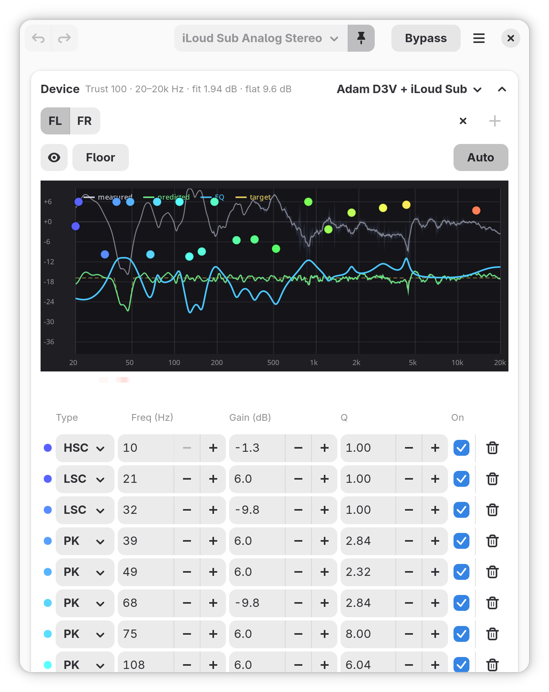
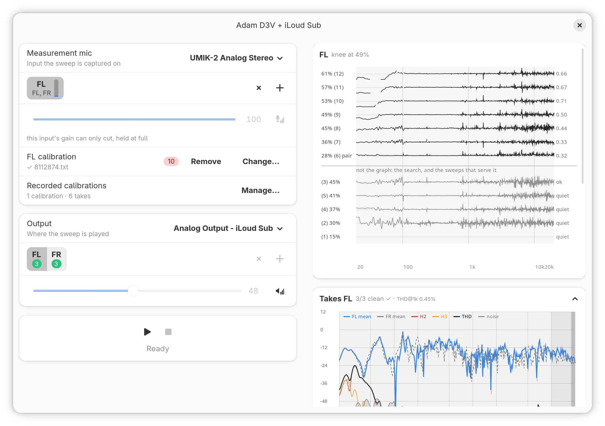

🇬🇧 English version: [README.md](README.md)

# per-device-eq — измерь и скорректируй любое устройство вывода прямо в PipeWire

`per-device-eq` измеряет колонки, наушники или IEM вашим собственным
измерительным ригом, подгоняет к результату параметрический эквалайзер и
применяет его как in-node filter-graph **внутри самого синка** — без
виртуального синка, без лишнего узла в графе, без фонового процесса.
Небольшой хук WirePlumber переприменяет коррекцию всякий раз, когда
устройство начинает играть, так что она переживает перезагрузку, hotplug и
переподключение Bluetooth, и при этом ничего вашего не запущено.

Поверх поустройственной коррекции живёт **слой вкуса**: ваш личный
эквалайзер, накладываемый после активного профиля на любом устройстве, в
том числе на устройстве без своего профиля, и никогда не трогающий
измеренные профили.





Проекты REW, AutoEq и EasyEffects вдохновили этот своим результатом; мне
хотелось той же корректности, но с большим удобством, поэтому весь цикл —
измерить, подогнать, применить, сохранить — живёт в одном приложении.

### Что даёт per-device-eq

- **Встроенное измерение.** Генерация свипа, захват, покапсюльная
  калибровка микрофона, усреднение тейков и ограниченный параметрический
  фит — приложение и есть измерительный прибор. Никакого внешнего
  измерительного софта.
- **Инкрементальные тейки.** Каждый принятый свип сохраняется в момент
  завершения. Добавляйте тейки между сессиями, удаляйте неудачный,
  пересчитывайте фит — профиль только улучшается.
- **За чем риг ещё поспевает.** Поиск уровня идёт выше того уровня, на
  котором меряет, и записывает, где риг перестаёт отдавать то, что
  просит коррекция. Полоса громкости закрашивает ту часть ручки, за
  которой он не поспевает, кривая там краснеет и называет себя
  *what you hear*, а строка говорит, какой пол перестанет столько
  просить. Каждый тейк по-прежнему хранит свои гармоники и свой шум.
- **По устройствам.** Каждый выход вместе с портом, через который он
  играет, — встроенные динамики, HDMI, конкретная Bluetooth-гарнитура (по
  MAC) в режимах Headphones и Handsfree, линейный выход карты и её выход
  на наушники — помнит свой эквалайзер и получает его обратно
  автоматически.
- **Вкус отдельно от коррекции.** Именованные слои предпочтений
  («Басхед», по одному на слушателя за общей машиной) накладываются
  поверх любого профиля и не ставят профилю метку `edited`. Они играют на
  всех устройствах, в том числе без своего профиля.
- **Честный запас.** Общий преамп с подсказкой Safe, посчитанной по
  композиции профиля и вкуса, живой пост-EQ метр и фит, который ложится
  сразу с корректным гейн-стейджингом, а не с клиппингом.
- **Интерактивный редактор.** Ручки бандов прямо на графике, поканальный
  эквалайзер, Bypass для A/B, Undo/Redo (`Ctrl+Z` / `Ctrl+Shift+Z`),
  строка доверия над графиком и Re-fit в один клик.

---

## Требования и установка

### AppImage (любой дистрибутив с PipeWire)

Скачайте `PerDeviceEQ-<версия>-x86_64.AppImage` со
[страницы выпусков](https://github.com/NTMan/PerDeviceEQ/releases),
сделайте файл исполняемым и запустите — без root и без установки:

    chmod +x PerDeviceEQ-*-x86_64.AppImage
    ./PerDeviceEQ-*-x86_64.AppImage

Внутри образа свои Python, GTK 4 и libadwaita; клиентские утилиты
PipeWire (`pw-dump`, `pw-cat`) берутся из вашего дистрибутива, как на любом
рабочем столе с PipeWire. Нижняя граница — glibc 2.42: Fedora 43+, Ubuntu
25.10+/26.04 LTS и любой rolling-дистрибутив (Arch, Gentoo, openSUSE
Tumbleweed). Debian 13 и Mint 22 ниже этой границы и не поддерживаются,
пока не появится сборка на более старой базе. База сборки — самая старая
из поддерживаемых Fedora. Файл `.zsync` рядом — канал автообновления для
AppImageUpdate.

**PipeWire ≥ 1.6** (нужен in-node `audioconvert.filter-graph`),
**WirePlumber**, **GTK 4** с **libadwaita ≥ 1.6**, **PyGObject**,
**PyCairo**, **Python 3**. Для измерения и живого метра дополнительно
нужны **python3-numpy**, **python3-scipy** и **python3-soundfile**. В
рантайме приложение зовёт `pw-metadata` и `pw-dump`; если чего-то нет, оно
скажет об этом при запуске.

### Fedora (COPR) — рекомендуемый путь

```
sudo dnf copr enable mikhail/per-device-eq
sudo dnf install per-device-eq
```

Ставятся лаунчер `per-device-eq`, хук WirePlumber (в
`/usr/share/per-device-eq/`) и desktop-запись с иконкой. Запускайте из меню
приложений как **Per-Device EQ** или командой `per-device-eq`. При первом
запуске баннер вверху окна сообщает, что интеграция не установлена;
кнопка **Install** ставит хук WirePlumber в вашу пользовательскую сессию
(WirePlumber один раз перезапускается). Убрать всё позже можно командой
`per-device-eq --uninstall`. Дальше эквалайзер восстанавливается сам при
каждой перезагрузке и переподключении.

### Хук переживает пакет

Удаление пакета (`dnf remove per-device-eq`,
`flatpak uninstall io.github.ntman.PerDeviceEQ`) НЕ удаляет хук из вашей
домашней папки: RPM не должен трогать домашние каталоги, а у Flatpak
вообще нет скриптов удаления — так устроены обе платформы. Уберите
интеграцию ДО удаления пакета (*Remove integration* в главном меню или
`--uninstall`). Если пакета уже нет, хук продолжает ставить последний
эквалайзер; в заголовках обоих установленных файлов написано, как их
убрать:

```
rm ~/.local/share/wireplumber/scripts/90-per-device-eq.lua
rm ~/.config/wireplumber/wireplumber.conf.d/90-per-device-eq.conf
systemctl --user restart wireplumber
```

### Обновление

Приложение передаёт хуку эквалайзеры через метаданные PipeWire, и
обновление может поменять формат этой передачи — так было в 5.1.0
(протокол хука 3). Установленный хук — это копия, вместе с пакетом она не
обновляется. Пока копия старая, на баннере в окне написано *The hook
speaks protocol 2, this app speaks 3*; кнопка **Retry** ставит хук из
обновления и заново отдаёт ему эквалайзеры всех устройств — то же делает
`per-device-eq --install`. Установка один раз перезапускает WirePlumber, и
Bluetooth-гарнитура, которая в этот момент играет, отключается; если она
не вернётся сама, подключите её заново.

### Запуск из исходников

```
# Fedora; в других дистрибутивах те же пакеты под другими именами:
sudo dnf install gtk4 libadwaita python3-gobject python3-cairo \
    python3-numpy python3-scipy python3-soundfile \
    pipewire pipewire-utils wireplumber
git clone https://github.com/NTMan/PerDeviceEQ.git
cd per-device-eq
chmod +x per-device-eq.py
./per-device-eq.py
```

Чтобы поставить системную интеграцию из чекаута, хук WirePlumber плюс
пункт меню с иконкой (обратимо; пишет только в `~/.local` и
`~/.config`):

```
./per-device-eq.py --install
./per-device-eq.py --uninstall
```

### Собрать RPM самому

Из корня чекаута на Fedora — та же сборка, которую CI делает на каждый
пуш:

```
sudo dnf install rpm-build dnf5-plugins
sudo dnf builddep per-device-eq.spec
rpmbuild -bb --build-in-place per-device-eq.spec
```

Пакет появится в `~/rpmbuild/RPMS/noarch/`.

### Flatpak

К каждому выпуску на [странице выпусков](https://github.com/NTMan/PerDeviceEQ/releases)
приложены пакеты для x86_64 и для aarch64:

```
flatpak install --user ./per-device-eq-x86_64.flatpak
```

Ему нужна среда выполнения GNOME 50 из Flathub
(`flatpak remote-add --user --if-not-exists flathub
https://dl.flathub.org/repo/flathub.flatpakrepo`). Самого приложения во
Flathub нет: заявку закрыли по их правилу о коде, написанном с помощью
ИИ. Хук WirePlumber ставится пунктом *Install integration* в главном
меню; из песочницы перезапустить WirePlumber нельзя, поэтому приложение
показывает команду, которую нужно выполнить на хосте.

---

# Как измерить устройство

Нужен измерительный риг, в который устройство сможет играть: ушной риг
(miniDSP EARS или купер класса 711) для наушников и IEM либо измерительный
USB-микрофон для колонок, плюс его калибровочные файлы по капсюлям.

Посадите устройство на риг, откройте пикер профилей на корректируемом
выходе и нажмите **+** (New) — правка существующего профиля открывает то
же окно на *его собственном* устройстве. Дальше окно читается сверху
вниз, и этот порядок — зависимость, а не привычка: микрофон настраивается
первым и не должен знать ничего о том, что будет играть; цель идёт
второй, потому что без неё некуда играть; уровень — последним, когда оба
конца уже есть. Ничего не угадывается за вас, и каждый ответ
запоминается, так что следующий профиль на том же стенде начинается с
шага 4.

1. **Выберите измерительный микрофон** в *Measurement mic* — вход, на
   который пишется свип.
2. **Объявите его каналы захвата.** Нажмите **+** на полосе, выберите
   цель, а затем канал захвата, который её слышит; в подменю у каждого
   канала живой уровень, так что ответ — стук и клик. У рига ровно те
   каналы, которые объявила рука, и никаких других: один объявленный
   канал пишет все цели, а при нескольких каждой цели назначается свой.
   У каждого канала свой файл **калибровки** (*Choose…* / *Change…*), а
   полоска на его вкладке живая — стукните по капсюлю, и шевельнётся та
   вкладка, куда он пришёл; так каналы различают, ничего не перетыкая.
3. **Откалибруйте чувствительность.** Кнопка рядом с фейдером усиления
   проходит усиление этого входа **в тишине** — ничего не играет — и
   находит точку, где собственный шум микрофона перестаёт тонуть в шуме
   преобразователя. Ниже неё отношение сигнал-шум выбрасывается впустую,
   выше — усиление уже ничего не покупает и стоит запаса. Вход без
   собственного аналогового усиления, например UMIK-1, говорит об этом
   под фейдером, и шаг пропускается; вход, чьё усиление умеет только
   убавлять, как у UMIK-2, остаётся на полном усилении, и шаг тоже
   пропускается.
4. **Выберите выход** в *Output* — куда играет свип.
5. **Объявите измеряемые каналы.** Цели сначала совпадают с
   именованными каналами выхода. **+** добавляет цель и спрашивает, какой
   канал выхода её играет, а крестик убирает цель, пока у неё нет
   тейков. Под вкладкой каждого капсюля напечатано, какие цели он пишет.
6. **Измерьте уровень.** Кнопка рядом с фейдером выхода ищет уровень
   воспроизведения пробными свипами, а затем проходит лестницу вверх от
   12 дБ ниже этого уровня — для канала, который сейчас открыт (подробнее
   в разделе *За чем риг ещё поспевает*). Уровень один на весь риг:
   фейдер показывает его и держит, пока у профиля есть паспорт. Без
   паспорта фейдер в ваших руках и начинает с уровня, на котором в
   последний раз мерили этот выход этим микрофоном.
7. **Наберите примерно три чистых тейка на канал.** Чистый помечен
   зелёной точкой: свип услышан, ничего не клипнуло, и кривая почти во
   всей полосе стоит минимум на 10 дБ над собственным шумом. Когда тейков
   три и больше, тейк, который отличается от остальных больше чем на
   3 дБ на трети октавы там, где остальные между собой согласны,
   становится жёлтым, и карточка тейков говорит, где именно.
   Пересаживайте устройство между тейками: разброс между
   тейками и подсказывает фиту, каким частотам верить. Каждый тейк
   сохраняется в момент завершения, корзинка на тейке удаляет его.

Карточка над тейками показывает среднюю кривую канала с полосой
разброса; ручки **EQ range** под ней следуют за доверенной полосой, пока
вы их не перетащите, а **Bands** задаёт бюджет фильтров фита. Закройте
окно — фит считается прямо на графике главного окна с поканальным
прогресс-баром, ложится с корректным гейн-стейджингом (Safe-преамп), и
профиль уже играет. Кнопка **Auto** над графиком пересчитает фит, когда
вы позже добавите или удалите тейки, а строка в заголовке карточки Device
говорит, насколько фиту можно верить и не устарел ли он.

### В чём признаётся тейк

Тейк записывает не только АЧХ. Он признаётся во второй и третьей
гармониках, в суммарных гармонических искажениях и в шуме, который
добавили комната и тракт; всё это рисуется под кривой в списке тейков и
сводится в заголовок панели как `THD@1k`. Там, где гармоника уходит за
пределы свипа, перо обрывается, а не догадывается, и график пишет над
этим участком *no harmonic evidence*.

### За чем риг ещё поспевает

Коррекция исходит из того, что риг ЛИНЕЕН: попросили на 60 Гц плюс
шесть децибел — получили шесть. С какого-то уровня это перестаёт быть
правдой: срывается порт, кончается ход диффузора, вступает лимитер. И
тогда предсказание на экране не приблизительно, а просто неверно.

Кнопка уровня в окне замера меряет, где это начинается, а профиль
хранит ответ как **паспорт** для каждого канала; паспорт нарисован
вверху правой колонки окна. Одно нажатие играет две вещи:

* **Поиск.** Пробные свипы, начиная с 15% громкости, ищут уровень, при
  котором пик захвата лежит между −11 и −2 dBFS, а сигнал минимум на
  41 дБ выше шума; целятся в −10.5. Каждая проба — строка под чертой со
  своим вердиктом: *loud*, *quiet* или *ok*. Тейки пишутся на том
  уровне, на котором поиск остановился.
* **Лестница.** Она начинается на 12 дБ ниже этого уровня и играет
  первую ступень дважды: расхождение этих двух свипов — разброс, с
  которым потом сравнивается каждое показание. До уровня поиска она
  доходит двумя шагами по 6 дБ и идёт дальше шагами по 2 дБ, пока у
  захвата не кончится запас до −2 dBFS, ручка не упрётся в максимум или
  не будет сыграно двенадцать ступеней. Каждая ступень — строка над
  чертой, самые громкие сверху; она нарисована относительно ступени ниже за
  вычетом её общего подъёма, так что ровная линия значит, что риг
  поспел.

Заголовок карточки говорит, где риг перестал поспевать (*knee at N%*),
или докуда он заведомо линеен. Если колено ниже уровня поиска, тейки
пишутся на шаг в 2 дБ ниже колена. Пока паспорт задаёт уровень, фейдер
показывает его и не двигается.

Чтобы переснять часть обхода, щёлкните строку и нажмите кнопку ещё раз:
ступень снимается заново вместе со всем, что выше, ступени ниже
остаются, и поиск не запускается; проба продолжает поиск с этого шага.
За одно нажатие играется не больше двенадцати проб и тринадцати свипов
лестницы.

Что редактор из этого делает:

* **Полоса уровня над карточкой устройства** дублирует системную
  громкость — читает синк и пишет в него, это не вторая громкость.
  Зелёное — измерено и поспевает, **красное** — измерено и не
  поспевает, **серое — не измерено**: обход часто кончается потому,
  что запас кончился у МИКРОФОНА, а не у рига, и красить это зелёным
  значило бы гадать.
* **Зелёная кривая** — предсказанный отклик, *predicted*, он виден с
  включённым глазом — **краснеет там, где риг не поспевает**, и меняет
  имя на *what you hear*: этот участок уже измерение, а не прогноз.
* **Метки под графиком** показывают задетые трети октавы.
* **Строка под ними** говорит, насколько это выше рига и какой пол
  перестанет столько просить.

Всё это читается на том уровне, который риг ПОЛУЧАЕТ, а не на
положении ручки: между ними стоят коррекция, её преамп, пол и слой
вкуса, и они — кривая, а не число. Частота, поднятая на 10 дБ против
преампа −10, получает ровно то же, что при свипе; двумя октавами выше
— на десять меньше.

### Floor

**Floor** — это фильтр высоких частот под коррекцией: ответ вуферу, у
которого просят ход, которого у него нет. Пока его ведёшь, за ручкой
идёт всё — закраска полосы, кривая, метки и строка, — так что сделка
видна, пока её совершают.

Две вещи стоит знать до того, как за него браться.

**С включённым Auto пол громкости не покупает.** Auto следует за пиком
цепи, поэтому срез выше освобождает запас, который Auto тут же отдаёт
соседним полосам: метки не исчезают, они лезут вверх. На здешнем
маленьком фазоинверторном мониторе срез до 40 Гц удвоил число меток и
стоил тринадцати пунктов безопасного уровня; тот же пол с
фиксированным преампом поднял его с 70% до 95%.

**И пол не починит того, чего у рига нет.** Там, где метки говорят,
что полосе не хватает, выбор один из трёх: просить меньше — полом или
громкостью — либо отдать эту полосу тому, кто её тянет. Инструмент не
выбирает; он показывает цену каждого выхода.

### Чего карта не покрывает

* **Она принадлежит ЦЕПИ, а не излучателю.** Ручка измерена через один
  усилитель; тот же наушник на более слабом на том же проценте выйдет
  на другой уровень, и карта не переносится. После смены усилителя,
  синка или аналогового регулятора на карте поиск нужно повторить.
* **Риг, стоящий У самой границы, читается там неустойчиво.** Три
  обхода одного наушника разошлись на 1.5 дБ ниже 30 Гц при нуле на
  килогерце — подпись посадки, а не драйвера. Это один экземпляр:
  остальные внутриканальные такого не показывали, но они и до границы
  не доставали.
* **Выше самой громкой ступени она молчит**, если обход остановил
  захват, а не риг. Это и есть серый участок, и на трёх из пяти
  здешних ригов обход кончился именно так. Он оставлен серым
  намеренно: колонка за границей шумит, а наушник за границей может
  не вернуться, и у TWS скромный усилитель и есть защита.
* **Каждая ступень, кроме первой, — один свип.** Первая играется
  дважды, и по её разбросу судят остальные. По Bluetooth одна ступень
  однажды пришла на 0.78 дБ ниже на нескольких десятках герц, чего не
  видели два других прогона. На проводных такого не встречалось.

### Колонки и UMIK

Меряйте в точке прослушивания, микрофон на высоте ушей. miniDSP даёт на
каждый экземпляр два калибровочных файла, и они не взаимозаменяемы:
каждый корректирует капсюль для ОДНОГО угла падения, а разница живёт в
верхах, где капсюль перестаёт быть всенаправленным. Этот сценарий гонит
свип через один динамик за раз, поэтому для стереопары направьте
микрофон **на активный динамик** и загрузите файл **0°**: коррекция
действует на прямой осевой звук, а 0° — кривая, снятая индивидуально
для вашего экземпляра. Для многоканальной системы направьте микрофон
**в потолок** с файлом **90°**: когда динамики вокруг, оси нет вовсе,
а вертикальный микрофон встречает каждый горизонтальный приход под
одними и теми же 90°, одна геометрия на все каналы. Ниже комнатного
перехода (грубо 200 Гц) файлы совпадают, так что для баса всё это
неважно. «Пересадка между тейками» по-прежнему означает сдвинуть
микрофон на ладонь вокруг кресла.

У UMIK-2 есть аналоговый предусилитель, но до него добирается только
утилита miniDSP для Mac и Windows: оба регулятора захвата, которые видит
Linux, стоят после преобразователя и умеют только убавлять, поэтому
приложение держит их на полном. Калибровочный файл UMIK-2 посчитан для
заводских +18 дБ, и если сдвинуть предусилитель, сдвинется и
чувствительность, записанная в файле.

### Вкус: ваш эквалайзер поверх всех устройств

Карточка **Taste** хранит ваши слои предпочтений: именованные, накрученные
руками эквалайзеры, которые накладываются после коррекции устройства на
*каждом* устройстве. Её кнопка показывает активный слой и открывает
**Preference EQ layers**: **+** создаёт новый слой, щелчок по строке
переключает на другой — удобно, когда за машиной по очереди двое, —
карандаш переименовывает, крестик удаляет, а **No layer** выключает вкус.
Раскройте карточку, чтобы править активный слой: там тот же график и та
же таблица бандов, что у устройства. Слои никогда не меняют измеренные
профили, а подсказки запаса считают композицию, так что басовый шельф
сверху не сможет клипануть за спиной у метра. Активный слой играет на
каждом выходе со звуковой картой, в том числе без своего профиля, и
правка доходит до всех сразу.

### Повседневная работа

- **Выбор выхода:** пока кнопка с булавкой нажата (а при запуске она
  нажата всегда), окно следует за системным выходом по умолчанию;
  отожмите её, чтобы окно осталось на выбранном выходе. В списке есть и
  порты других профилей карты, и выбор такого порта переключает карту на
  этот профиль.
- **Выбор профиля** (кнопка в заголовке карточки Device): переключает
  профиль, привязанный к текущему выходу и порту; **+** измеряет новый,
  иконка папки импортирует профиль, которым поделился кто-то другой, а
  каждую строку можно дублировать, править или убрать. `Default (no EQ)`
  значит, что своей коррекции у устройства нет: вкус и преамп на нём всё
  равно играют, пол — нет.
- **Bypass** для A/B с необработанным звуком: снимает с устройства в окне
  всю цепочку — банды, пол, вкус и преамп. Загрузка профиля или
  устройства и правка банда выключают его. В профиль он не сохраняется,
  но хук его помнит: устройство, оставленное в Bypass, так и играет без
  обработки, в том числе после перезагрузки, пока окно снова не откроется
  на нём.
- **Преамп:** в режиме **Auto** каждое устройство получает своё значение
  Safe — самый большой подъём его итоговой кривой, взятый со знаком
  минус; если поменять число, включится одно ручное значение на все
  устройства.
- **Ручная доводка:** тяните точку на графике, клик по пустому месту
  добавляет банд, правый клик убирает; или правьте таблицу. Ручные правки
  отжимают **Auto** и помечают фит как `edited`; нажатое **Auto**
  пересчитывает фит и спрашивает, прежде чем снести правки. Доводку под
  вкус лучше делать в слое **Taste**, а не в коррекции устройства: тогда
  коррекции остаются измеренными и все устройства играют одинаково
  правильно.
- **Поканальный эквалайзер:** каждая вкладка соединяет канал выхода с
  каналом профиля. Профиль с одним каналом играет на всех каналах выхода;
  иначе каналы сопоставляются по именам, а если имена не совпадают — по
  порядку. **+** проигрывает канал профиля ещё на одном канале выхода;
  крестик на вкладке оставляет этот канал выхода без коррекции, но пол,
  вкус и преамп на нём остаются.

---

## Командная строка

```
./per-device-eq.py --list-sinks      # список синков (дефолт помечен *)
./per-device-eq.py --list-sources    # список источников захвата
./per-device-eq.py --list-profiles   # профили и их привязки к устройствам
./per-device-eq.py --inspect NAME    # параметры синка (node.name)
./per-device-eq.py --apply           # отдать хуку эквалайзеры привязанных устройств и вкус для остальных
./per-device-eq.py --install         # поставить хук + десктоп-интеграцию
./per-device-eq.py --uninstall       # убрать хук + десктоп-интеграцию
./per-device-eq.py --bridge A B      # измеренная разница двух профилей одного устройства на двух ригах
```

`--bridge` пишет в `bridge-out/`, если `--out DIR` не указывает другой
каталог; `--published CURVE` добавляет доверенную кривую того же
устройства (текст частота/дБ), с которой сверяется B.

## Файлы

| Путь                                                             | Что это                                                                   |
| ---------------------------------------------------------------- | ------------------------------------------------------------------------ |
| `~/.config/per-device-eq/profiles/*.json`                        | ваши профили (банды, тейки, метаданные фита)                              |
| `~/.config/per-device-eq/preference-layers.json`                 | слои вкуса и какой из них активен                                         |
| `~/.config/per-device-eq/bindings.json`                          | по устройству (`node.name#порт`, у узла без карты просто `node.name`): его профиль и какой канал профиля кормит какой его собственный |
| `~/.config/per-device-eq/ui-state.json`                          | режим преампа и его ручное значение, какие из карточек Device и Taste раскрыты |
| `~/.config/per-device-eq/favorites.json`                         | встроенные профили, закреплённые в пикере                                 |
| `~/.config/per-device-eq/mic-profiles.json`                      | измерительные микрофоны: какой источник и гнездо они узнают, калибровка и рабочая точка каждого канала захвата |
| `~/.config/per-device-eq/measure-state.json`                     | по выходу: последний микрофон и последний уровень, на котором выход хорошо измерился |
| `~/.local/share/wireplumber/scripts/90-per-device-eq.lua`        | хук персистентности (статический скрипт, ставится из репозитория как есть)|
| `~/.local/state/wireplumber/per-device-eq`                       | таблица хука, её пишет сам хук: собственный граф каждого устройства или явное «ничего», и запись вкуса `@taste`, которая играет на остальных; на старте читается, только если в ней тот же протокол |
| `~/.config/wireplumber/wireplumber.conf.d/90-per-device-eq.conf` | загружает хук и создаёт объект метаданных `per-device-eq`                 |
| `~/.config/per-device-eq/export-targets/*.json`                  | ваши собственные цели экспорта (ниже); приложение его не создаёт, читает если создали руками |
| `profiles/clean.json`, `/usr/share/per-device-eq/profiles/`      | встроенные / системные профили                                            |

### Свои цели экспорта

Список целей в мастере экспорта -- это встроенные плюс JSON-дропины из
`~/.config/per-device-eq/export-targets/`. Приложение этот каталог не
создаёт; сделайте его руками, и мастер начнёт его читать.

Один файл -- либо один объект цели, либо список. Цели нужны `id`, `name`
и `writer` из известного мастеру набора (`pdeq`, `parametric`,
`graphiceq`, `poweramp`, `fixed`); необязательные -- `ext`, `note`,
`max_bands`, `presets`. **Дропин, чей `id` совпал со встроенной целью,
заменяет её на месте**; новые `id` дописываются в порядке имён файлов.
Битый файл или запись пропускаются со строкой в stderr, а не роняют
мастер.

Это шов для плеера, цели под который мы не поставляем, и для замены
поставляемой, когда у конкретного приёмника свои повадки.

```json
{ "id": "my-player", "name": "My player", "writer": "parametric",
  "ext": ".txt", "max_bands": 8,
  "note": "eight bands, no shelves" }
```

## Разработка: аудит-инструменты и тесты

Каталог `tools/` содержит инструментарий аудита измерений и клиппинга; план
разработки живёт в [ROADMAP.md](ROADMAP.md). Тесты: `python3 -m pytest
tests/`, фикстуры генерируются на лету и детерминированы. Реальные записи
(включая защищённый авторским правом материал) живут только в
`tests/fixtures-local/` (в gitignore), никогда в репозитории.

У хука свои тесты: `tests/test_hook.py` гоняет
`wireplumber/90-per-device-eq.lua` на поддельном WirePlumber
(`tests/hook_harness.lua`), для этого нужен интерпретатор Lua (`lua`); без
него этот тест пропускается.

## Известные проблемы

- **Просадка громкости после включения EQ — исправлено в PipeWire
  1.6.8.** На синках с аппаратной громкостью первое изменение громкости
  *после* активации in-node EQ могло обрушить реальный уровень при
  корректно выглядящем отображаемом: filter-graph съедал свойства
  softVolume/softMute вместо того чтобы пропустить их дальше, и
  поканальная громкость применялась дважды, в железе и ещё раз в
  софте. Исправлено апстримом в **1.6.8**
  (<https://gitlab.freedesktop.org/pipewire/pipewire/-/work_items/5344>);
  на 1.6.7 и старше — выставить громкость до включения EQ либо
  `systemctl --user restart wireplumber`.
- **Две одинаковые карты могут обменяться профилями.** Два экземпляра
  одной модели могут сообщать один и тот же серийный номер, и WirePlumber
  называет их `...-00` и `...-00.2` в том порядке, в каком увидел. Профиль
  привязан к этому имени, а не к USB-порту, поэтому если карты появятся в
  другом порядке (после перезагрузки или переподключения), их профили
  поменяются местами. Привязка к USB-порту закрепила бы профиль за
  гнездом, и при переносе карты в другой порт он бы терялся; приложение
  выбрало первое.
- **Установка и обновление хука перезапускают WirePlumber**, и
  Bluetooth-гарнитура, которая в этот момент играет, отключается. Если она
  не вернётся сама, подключите её заново.
